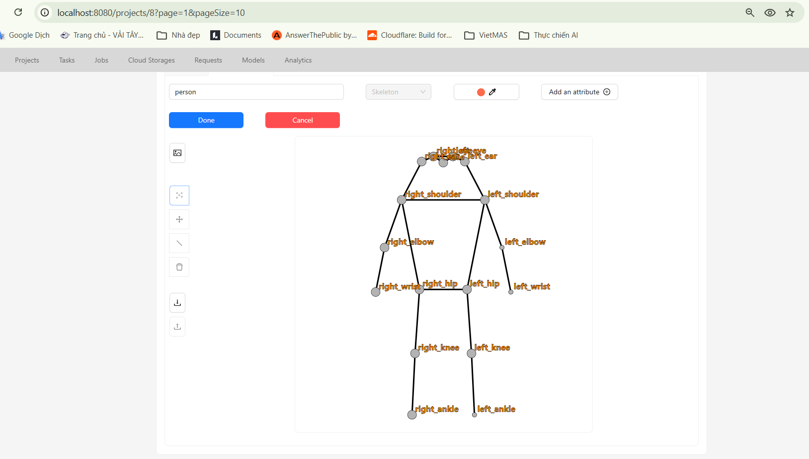
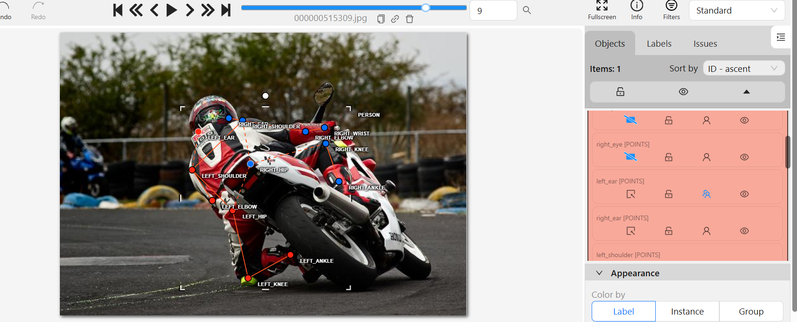
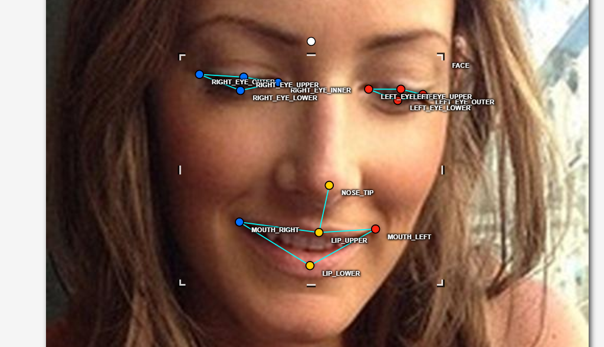
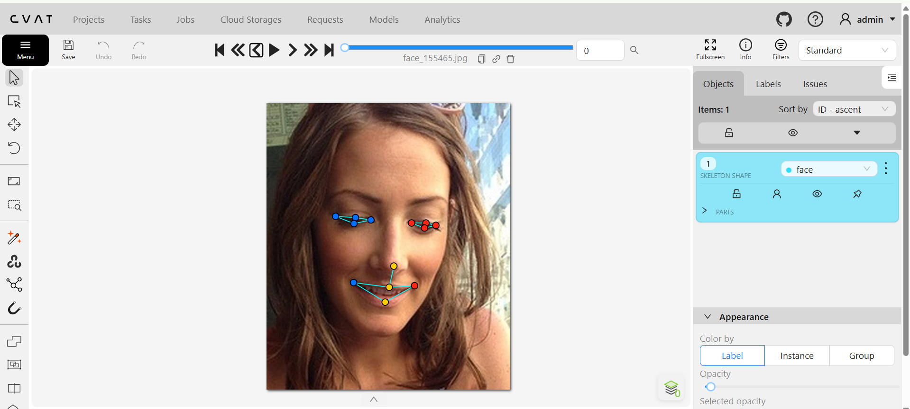

# Báo cáo cá nhân — Day 4 Keypoint & Pose

## 0. Thông tin học viên

- Họ tên: Nguyen Quang Thuc
- MSSV: 2A202603116
- Email: nguyenquangthuc.info@gmail.com
- Link repository: https://github.com/ThucNguyen-97/K5-L2A-Day4-NguyenQuangThuc-2A202603116-KeypointPose-S
- Phiên bản CVAT: 2.82.0
- Máy / thời gian làm bài: **Anh bổ sung**
- `src/exports/assignment.json`: Có

## 1. Kiểm tra label (CP0)

| Label | Kiểu | Số điểm | Đúng tên / thứ tự | Số cạnh |
|---|---|---:|---|---:|
| `person` | Skeleton | 17 | Có | 19 |
| `face` | Skeleton | 13 | Có | 13 |

Mẫu `person` dựng theo người quay mặt về camera: Có.

Cách đổi cờ: chọn một điểm trong skeleton, mở thuộc tính của điểm ở sidebar, rồi bật `Occluded` hoặc `Outside` tùy trường hợp.

## 2. Số lượng đã gán (CP1, CP2)

| Nhóm ảnh | Số ảnh | Số skeleton |
|---|---:|---:|
| `easy` | 5 | 5 |
| `occluded` | 3 | 6 |
| `back` | 2 | 3 |
| `small` | 1 | 3 |
| `crowd` | 1 | 1 |
| `faces` | 8 | 8 |

Không ghi nhận ca khó đáng kể trong quá trình gán nhãn. Thời gian thực tế: **Anh bổ sung**.

## 3. Bảng ca khó (CP1, CP2)

Không có ca khó đáng kể theo đánh giá của người gán nhãn.

## 4. Bảng tự review (CP3)

| Ảnh | Nhóm | Điểm / nội dung | Mã | Ghi chú |
|---|---|---|---|---|
| `000000188804.jpg` | người | ankle | `lr_swap` | Script cảnh báo; cần đối chiếu với tư thế thực tế |
| `000000308257.jpg` | người | ankle | `lr_swap` | Script cảnh báo; cần đối chiếu với tư thế thực tế |
| `000000515309.jpg` | người | elbow | `lr_swap` | Script cảnh báo; cần đối chiếu với tư thế thực tế |
| `000000522889.jpg` | người | knee, ankle | `lr_swap` | Script cảnh báo; cần đối chiếu với tư thế thực tế |
| `face_155465.jpg` | mặt | — | `ok` | Không có lỗi từ script |
| `face_219250.jpg` | mặt | — | `ok` | Không có lỗi từ script |
| `face_421231.jpg` | mặt | — | `ok` | Không có lỗi từ script |
| `face_442231.jpg` | mặt | — | `ok` | Không có lỗi từ script |

Tổng hợp: `lr_swap` = 4 · `vis_flag` = 0 · `position` = 0 · `missing` = 0 · `extra` = 0 · `ok` = 4.

## 5. Kiểm file xuất và kết quả tự kiểm (CP4)

- `NguyenQuangThuc_persons.zip`: 12 ảnh, 18 skeleton `person`, mỗi annotation 51 số.
- `NguyenQuangThuc_faces.zip`: 8 ảnh, 8 skeleton `face`, mỗi annotation 39 số.
- Cờ: `v=2` là nhìn thấy, `v=1` là bị che nhưng ước lượng được, `v=0` là ngoài ảnh / không đoán được.
- Số lỗi: 0 · số cảnh báo: 4.
- Kết quả script: **ĐẠT**.
- Hai job CVAT đã chuyển sang `completed`: Có.

Tóm tắt tự kiểm:

```text
Person: 12 ảnh · 18 skeleton · v=2: 219 · v=1: 35 · v=0: 52 · num_keypoints trung bình: 14.1
Face: 8 ảnh · 8 skeleton · v=2: 94 · v=1: 10 · v=0: 0 · num_keypoints trung bình: 13.0
Số lỗi: 0 · số cảnh báo: 4
Kết quả: ĐẠT
```

## 6. Ảnh chụp màn hình

1. Label `person` / skeleton người:

   

2. Một ca người đã gán skeleton:

   

3. Khuôn mặt đã gán 13 điểm, phóng to vùng mắt:

   

4. Đoạn JSON export có `keypoints` và `num_keypoints`:

   

Nguồn ảnh: COCO val2017 / Wikimedia Commons.

## 7. Tự đánh giá

- Lỗi / điểm cần chú ý: script còn cảnh báo trái-phải ở 4 skeleton; cần kiểm tra lại khi review cuối.
- Ca khó: không ghi nhận ca khó đáng kể.
- Nhãn được dùng để huấn luyện model pose thông qua tọa độ keypoint và cờ visibility trong mảng COCO `keypoints`.

## 8. Khó khăn và lỗi kỹ thuật

Không ghi nhận lỗi kỹ thuật nghiêm trọng. Thông tin hệ điều hành, RAM và thời gian làm bài: **Anh bổ sung**.

## 9. Tài liệu tham khảo và công cụ AI

- Tài liệu tham khảo bên ngoài: Không sử dụng.
- Công cụ AI: LLM Codex hỗ trợ xuất file và chạy kiểm tra sau khi hoàn tất gán nhãn.
